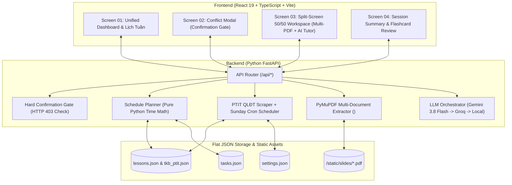

# PROJECT PROPOSAL — GDGOC PTIT PROBATION 2026

| Thông tin dự án | Chi tiết |
| :--- | :--- |
| **Tên dự án** | **EasyPlan AI Agent** — Trợ lý Học tập Chủ động & Đồng bộ Lịch QLĐT PTIT |
| **Tên team** | **Walleye** (GDGoC PTIT Probation) |
| **Team Leader** | **Nguyễn Văn Đức** |
| **Mentor** | **Trần Trung Hiếu & Vũ Thu Duyên** |
| **Thời gian nộp** | 23 / 10 / 2026 |

---

## 1. THÔNG TIN TEAM

| STT | Họ và tên | Vai trò / Lĩnh vực | Công việc phụ trách & Đầu ra thực tế (Deliverables) |
| :---: | :--- | :--- | :--- |
| **1** | **Nguyễn Văn Đức** | **Team Leader** / Điều phối & Tích hợp Core Flow | Chốt cấu trúc dữ liệu phẳng (`lessons.json`, `tasks.json`, `settings.json`) và 8 API Contracts giữa Frontend – Backend; ghép nối toàn bộ luồng Core User Flow chạy thông suốt từ đầu đến cuối (Lấy lịch QLĐT $\rightarrow$ Báo trùng lịch $\rightarrow$ 1-Click vào học $\rightarrow$ AI Trợ giảng $\rightarrow$ Tổng kết); xử lý các kịch bản lỗi biên (edge cases) và duyệt ấn phẩm trước khi nộp BTC. |
| **2** | **Nguyễn Đức Tú** | **Member** / AI Agent & Xử lý tài liệu (Multi-PDF) | Triển khai tool `extract_document_content` & `extract_multi_documents_content` (`PyMuPDF` + `ocr_fallback`) bóc tách văn bản từ 1 hoặc nhiều slide/PDF bài học; xây dựng tool `generate_study_roadmap` sinh lộ trình học tập; xây dựng tool `query_llm_tutor` gọi API **Gemini 3.8 Flash** (cấu hình sẵn fallback sang **Groq API**) kèm ngữ cảnh lịch học + nội dung slide `<DOCUMENT_DATA>` để giải bài, tóm tắt lý thuyết, gỡ bug code; làm logic `inactivity_check_trigger` (sau 10p không thao tác tự gửi câu hỏi thăm kèm Cooldown 300s), tạo Flashcard ôn tập và kịch bản dữ liệu mock cho tính năng Dự báo trễ hạn. |
| **3** | **Hà Trần Anh Quân** | **Member** / Quản lý Lịch & Thuật toán Sắp xếp | Đóng gói tool `sync_qldt_schedule` / `fetch_qldt_schedule` (`qldt_client.py` — dùng Python `requests` lấy TKB từ cổng QLĐT PTIT, lưu tài khoản 1 lần, tự động đồng bộ mỗi Chủ Nhật, gộp các tiết liên tiếp lưu vào `lessons.json` + chuẩn bị sẵn file JSON tĩnh dự phòng `tkb_ptit.json` khi QLĐT sập/hết token). Viết thuật toán `resolve_conflicts_and_reschedule` tìm slot trống khi lịch trường đè lên lịch tự học (`apply_reschedule`) sau khi người dùng xác nhận. |
| **4** | **Nguyễn Đình Quyết Thắng** | **Member** / Nền tảng Web & Backend Gateway | Dựng khung dự án Frontend (React 19 + TypeScript + Vite) và Backend (Python + FastAPI). Xây dựng hệ thống REST API endpoints (`routes.py`) kết nối UI với 6 tools của Agent và đọc/ghi nguyên tử `lessons.json`, `tasks.json`, `settings.json` (`json_storage.py`). Cài đặt chốt chặn xác nhận cứng (**Hard Confirmation Gate** — `HTTP 403 Forbidden` trong `confirmation.py`) đối với mọi thao tác ghi/dời lịch và lưu lộ trình. |
| **5** | **Đàm Quốc Vinh** | **Member** / Frontend - Không gian học tập (Workspace) | Code giao diện **Screen 03 (Split-screen 50/50 Deep Working Workspace)**: cột trái tích hợp Multi-PDF Viewer mở sẵn nhiều slide môn học (hỗ trợ chuyển tab, tải thêm/gỡ file PDF), cột phải gồm đồng hồ **Pomodoro 25:00**, checklist `subtasks` (từ `tasks.json`), khung Chat AI Trợ giảng (hiển thị Markdown/Code Debug) và Flashcard. Gắn bộ đếm 10 phút không thao tác chuột/phím để gọi trigger hỏi thăm. Code **Screen 04 (Session Summary Card)** hiển thị thống kê Pomodoro, tỷ lệ hoàn thành task và lưu tiến độ. |
| **6** | **Nguyễn Mai Trang** | **Member** / Frontend - Dashboard & Thiết kế Truyền thông | Code giao diện **Screen 01 (Unified Dashboard)**: Lưới lịch tuần phân biệt lịch trường cố định (`lessons.json`), lịch tự học (`tasks.json`) và lịch xung đột; thanh thông báo **1-Click vào học ngay**; sidebar To-do list nội bộ & Widget Dự báo trễ hạn; form **"Tạo lộ trình AI (Upload nhiều PDF + Chọn ngày thi/thời lượng)"** và **Screen 02 (Modal cảnh báo xung đột lịch kèm nút bấm Xác nhận)**. Thiết kế bộ 4 màn hình Figma và Poster dự án khổ tỉ lệ 4:5 nộp BTC. |
| **7** | **Ngô Minh Kiệt** | **Member** / Quản lý Tiến độ & Kiểm thử (QA/Tracking) | Tổng hợp báo cáo tiến độ tuần theo khung 5 mục (Requirement, Current Status, Evidence, Risk/Blocker, Next Action). Chuẩn bị bộ dữ liệu mẫu (`seed_data.py`: các file PDF bài giảng mẫu, kịch bản lịch bị trùng tại Tuần 10, danh sách task mẫu trong `tasks.json`). Phối hợp kiểm thử toàn bộ luồng End-to-End (`tests/test_api.py` gồm 15/15 test cases đạt chuẩn) và kiểm tra 4 kịch bản lỗi biên (edge cases) của Agent. |
| **8** | **Nguyễn Minh Ngọc** | **Member** / Nội dung Truyền thông, Proposal & Slide | Viết bài giới thiệu tổng quan giải pháp/sản phẩm EasyPlan (80–100 từ) kèm Poster để nộp BTC phục vụ đăng bài Fanpage. Biên soạn và cập nhật tài liệu Project Proposal chi tiết (Core Features, Scope, User/Screen Flow, Architecture, Agent Flow) và dựng khung Slide thuyết trình cho Demo Day. |

---

## 2. TỔNG QUAN DỰ ÁN

* **Mô tả ngắn:**
  **EasyPlan AI Agent** là nền tảng trợ lý học tập chủ động kết hợp quản lý thời khóa biểu thông minh dành cho sinh viên PTIT, giúp giải quyết xung đột giữa lịch học cố định trên trường (cổng QLĐT) với lịch tự học cá nhân và xóa bỏ ma sát khi bắt đầu ngồi vào bàn học bằng cách tự động cào lịch QLĐT mỗi Chủ Nhật, đề xuất dời lịch có chốt chặn xác nhận (**Confirmation Gate**), sinh lộ trình học từ nhiều file PDF và mở phòng học 50/50 chỉ với 1 cú nhấp chuột. Prototype cuối kỳ minh họa trọn vẹn luồng 8 bước hoạt động từ đồng bộ lịch QLĐT thực tế, xử lý xung đột lịch, tạo lộ trình đa tài liệu PDF đến hỏi đáp lý thuyết & debug code trực tiếp với AI Trợ giảng (**Gemini 3.8 Flash** + **Groq Fallback**).
* **Từ khóa dự án:**
  `Giáo dục đại học (EdTech)` · `AI Agent` · `Đồng bộ lịch QLĐT PTIT` · `Trợ giảng AI (Gemini 3.8 Flash)` · `Multi-PDF RAG` · `Quản lý thời gian (Deep Work / Pomodoro)`

---

## 3. PROBLEM & TARGET USER

### 3.1. Bối cảnh và vấn đề
* **Bối cảnh:** Tại Học viện Công nghệ Bưu chính Viễn thông (PTIT), lịch học trên cổng Quản lý Đào tạo (`qldt.ptit.edu.vn`) thường xuyên biến động giữa học kỳ (bổ sung lịch học bù, tách/gộp tiết, đổi phòng học hoặc lịch học trực tuyến), ảnh hưởng trực tiếp tới sinh viên các môn cơ sở ngành nặng về lý thuyết và lập trình (như *Cấu trúc dữ liệu & Giải thuật - INT1306*, *Toán rời rạc 2 - INT1359*, *Điện tử số - ELE1309*).
* **Pain point 1 (Xung đột lịch học & Đứt gãy kế hoạch tự học):** Khi nhà trường bổ sung lịch học bù hoặc thay đổi lịch trên cổng QLĐT đè vào khung giờ sinh viên đã lên kế hoạch tự học, các công cụ lịch truyền thống (Google Calendar, Notion) không tự động phát hiện và sắp xếp lại, khiến sinh viên bỏ lỡ buổi tự học và dồn bài sát kỳ thi.
* **Pain point 2 (Ma sát khởi đầu lớn & Bế tắc khi tự đọc Slide / Debug Code):** Mỗi khi bắt đầu học, sinh viên mất nhiều thời gian lục tìm nhiều file Slide PDF bài giảng, đề bài tập ở các nơi khác nhau; đồng thời khi gặp thuật toán khó (như duyệt cây nhị phân, khử đệ quy bằng Stack) hoặc lỗi code (`Segmentation Fault`) lúc nửa đêm thì không có trợ giảng giải đáp sát với nội dung slide của trường.
* **Giải pháp hiện tại / hạn chế:** Sinh viên đang phải đăng nhập QLĐT thủ công để tra lịch, tự nhập tay vào lịch cá nhân, mở từng file PDF rời rạc và copy-paste sang các chatbot chung chung (như ChatGPT web) vốn không nắm được lịch rảnh, không đọc đồng thời bộ slide của buổi học và không theo dõi tiến độ checklist.

### 3.2. Người dùng mục tiêu
* **Nhóm người dùng chính:** Sinh viên đại học tại PTIT (đặc biệt là sinh viên năm 1–3 khối CNTT / Kỹ thuật) có lịch học trên trường thay đổi theo tuần và thường xuyên tự học qua tài liệu Slide PDF kết hợp làm bài tập lập trình.
* **Nhu cầu / tình huống:** Khi bước vào tuần học mới hoặc chuẩn bị kiểm tra, sinh viên cần hệ thống tự động cập nhật lịch trường từ QLĐT, cảnh báo ngay nếu lịch trường đè lên lịch tự học kèm gợi ý giờ trống thay thế; và khi đến giờ tự học, chỉ cần bấm 1 nút để mở sẵn toàn bộ file PDF của buổi học kèm checklist và trợ giảng AI hỗ trợ giải thích bài/sửa lỗi code tại chỗ.

---

## 4. PROPOSED SOLUTION

* **Giải pháp đề xuất:**
  **EasyPlan AI Agent** cung cấp quy trình khép kín trên một nền tảng Web duy nhất:
  1. Người dùng chỉ nhập tài khoản QLĐT PTIT **1 lần duy nhất**, Agent tự động cào lịch vào mỗi Chủ Nhật hàng tuần (hoặc khi người dùng bấm nút Đồng bộ) và tự động gộp các tiết liên tiếp lưu vào `lessons.json`.
  2. Tự động phát hiện xung đột giữa lịch cố định trên trường (`lessons.json`) và lịch tự học cá nhân (`tasks.json`), đề xuất khung giờ trống qua cửa sổ **Confirmation Gate (Screen 02)** để người dùng duyệt.
  3. Trích xuất văn bản từ **nhiều file PDF bài giảng** bằng `PyMuPDF` để tạo lộ trình ôn tập (`subtasks`) trước ngày thi.
  4. Cung cấp **Phòng học 50/50 một chạm (Screen 03 - 1-Click Deep Working Workspace)** hiển thị nhiều file PDF bên trái và Đồng hồ Pomodoro + Checklist + AI Trợ giảng + Flashcard bên phải, kết thúc bằng **Thẻ tổng kết tiến độ (Screen 04)**.
* **Liên kết với vấn đề:**
  Xử lý triệt để **Pain point 1** bằng cơ chế đồng bộ QLĐT tự động kết hợp thuật toán phát hiện xung đột & tìm khe giờ trống bằng Python thuần (`planner.py`); xử lý **Pain point 2** bằng Banner *"1-Click Vào Tự Học Ngay"* nạp sẵn đa tài liệu PDF cùng AI Trợ giảng (**Gemini 3.8 Flash**) đọc hiểu toàn bộ slide của buổi học để giải thích lý thuyết, debug code C/C++/Python và chủ động nhắc nhở sau 10 phút không thao tác.
* **Giá trị / điểm đáng chú ý:**
  Đảm bảo tính an toàn và quyền kiểm soát cho sinh viên nhờ chốt chặn cứng **Hard Confirmation Gate** (`HTTP 403 Forbidden` — AI chỉ đề xuất, tuyệt đối không tự ý sửa lịch nếu người dùng chưa bấm xác nhận); tách biệt rõ toán học thời gian bằng Python thuần (tránh hoàn toàn lỗi ảo giác ngày giờ của LLM); và hỗ trợ đính kèm nhiều tài liệu PDF trong cùng một phiên học.

---

## 5. CORE FEATURES

| Tính năng | Mô tả ngắn | Mức ưu tiên | Có trong prototype? |
| :--- | :--- | :---: | :---: |
| **1. Đồng bộ lịch QLĐT PTIT & Tự động gộp tiết** | Đăng nhập QLĐT 1 lần, tự động cào lịch mỗi Chủ Nhật hoặc theo yêu cầu; tự động gộp các tiết liền kề cùng môn/phòng lưu vào `lessons.json` và chuyển về dữ liệu dự phòng (`tkb_ptit.json`) nếu cổng QLĐT lỗi. | Cốt lõi | **Có (Đã hoàn thiện)** |
| **2. Phát hiện xung đột lịch & Chốt chặn Confirmation Gate** | Đối chiếu lịch cố định trên trường (`lessons.json`) với lịch tự học linh hoạt (`tasks.json`), tìm khe giờ trống trong ngày và hiển thị Modal xin xác nhận (`HTTP 403` nếu chưa xác nhận) trước khi cập nhật lịch. | Cốt lõi | **Có (Đã hoàn thiện)** |
| **3. Tạo lộ trình tự học AI từ nhiều file Slide PDF** | Tải lên hoặc chọn nhiều file PDF môn học, nhập ngày thi và số giờ rảnh; hệ thống trích xuất văn bản bằng `PyMuPDF`, chia buổi học + checklist `subtasks` vào các khung giờ trống. | Cốt lõi | **Có (Đã hoàn thiện)** |
| **4. Phòng học tập trung 50/50 (1-Click Multi-PDF Workspace)** | Bấm 1 nút từ Banner trang chủ vào thẳng phòng học: cột trái xem & chuyển đổi nhiều file PDF; cột phải gồm đồng hồ Pomodoro 25:00, Checklist mục tiêu và ghi chú cá nhân. | Cốt lõi | **Có (Đã hoàn thiện)** |
| **5. AI Trợ giảng ngữ cảnh Slide, Debug Code & Nhắc nhở chủ động** | Hỏi đáp lý thuyết bám sát các file PDF đính kèm (`<DOCUMENT_DATA>`), tìm lỗi code C++/Python với **Gemini 3.8 Flash** (fallback **Groq**) và chủ động hỏi thăm sau 10 phút đứng hình (Cooldown 300s). | Cốt lõi | **Có (Đã hoàn thiện)** |
| **6. Thẻ Tổng kết phiên học, Flashcard & Dự báo trễ hạn** | Thống kê số phút tập trung Pomodoro & tỷ lệ hoàn thành checklist (Screen 04), tự động tạo bộ thẻ lật Flashcard từ slide PDF và hiển thị Widget cảnh báo rủi ro trễ hạn (Mock). | Mở rộng | **Có (Đã hoàn thiện)** |

---

## 6. PROTOTYPE SCOPE

* **Prototype sẽ thể hiện:**
  * **Luồng sử dụng chính:** Đồng bộ lịch QLĐT PTIT (Tuần 1–31) $\rightarrow$ Phát hiện xung đột với phiên tự học tại Tuần 10 & Duyệt dời lịch qua Confirmation Gate $\rightarrow$ Tạo lộ trình học từ nhiều file PDF $\rightarrow$ Bấm 1-Click vào Phòng học 50/50 $\rightarrow$ Chuyển đổi đa tài liệu PDF, chạy Pomodoro, hỏi AI Trợ giảng (lý thuyết & debug code), nhận nhắc nhở sau 10 phút đứng hình $\rightarrow$ Lật thẻ Flashcard & Xem thẻ Tổng kết cuối buổi.
  * **Ý tưởng / chức năng cốt lõi được chứng minh:** (1) Khả năng kết nối API QLĐT thực tế kèm fallback an toàn; (2) Chốt chặn Confirmation Gate (`HTTP 403`) ngăn AI tự tiện sửa lịch; (3) Khả năng đọc hiểu đồng thời nhiều file PDF bằng `PyMuPDF` và trả lời/debug code chính xác qua **Gemini 3.8 Flash** + **Groq Fallback**.
  * **Đầu ra người xem có thể quan sát:** 4 màn hình Web thực tế (Screen 01: Dashboard Lịch tuần 3 màu, Screen 02: Modal xử lý xung đột, Screen 03: Phòng học 50/50 đa PDF + Chat Markdown + Pomodoro + Flashcard, Screen 04: Màn hình Tổng kết phiên học) cùng bộ **15/15 test cases tự động (`pytest`)** đạt `PASSED`.
* **Có thể mô phỏng hoặc dùng dữ liệu mẫu (`Mock data / dịch vụ giả lập`):**
  1. Widget *"Dự báo nguy cơ trễ hạn"* trên Dashboard hiển thị chỉ số rủi ro giả lập (`is_mock: true`, `78%`) để minh họa tính năng cảnh báo sớm.
  2. Khi cổng QLĐT PTIT bảo trì hoặc người dùng chưa nhập tài khoản, hệ thống tự động dùng file dữ liệu thực tế đã lưu (`tkb_ptit.json` gồm 131 buổi học của 31 tuần).
* **Ngoài phạm vi Probation (`Chưa thực hiện`):**
  Tích hợp dịch vụ lịch bên thứ ba (Google Calendar OAuth2), xác thực đa người dùng (Multi-tenant Authentication), ứng dụng di động gốc (Native iOS/Android), thông báo đẩy qua Email/SMS và thanh toán thương mại.

---

## 7. USER FLOW & PROTOTYPE DESIGN

### 7.1. Luồng sử dụng chính
* **Tên luồng:** Luồng 1 (Cốt lõi): Đồng bộ lịch QLĐT, Xử lý xung đột qua Confirmation Gate & Học tập 1-Click trong Phòng học 50/50 Đa tài liệu PDF.
* **Các bước:**
  `[Mở Dashboard / Bấm Đồng bộ lịch QLĐT]` $\rightarrow$ `[Hệ thống cào lịch QLĐT, gộp tiết & phát hiện trùng lịch tại Tuần 10]` $\rightarrow$ `[Hiển thị Modal Xung đột (Screen 02): Người dùng bấm 'Đồng ý dời lịch']` $\rightarrow$ `[Bấm Banner 'VÀO TỰ HỌC NGAY →' (1-Click Enter)]` $\rightarrow$ `[Phòng học 50/50 (Screen 03) mở sẵn các file PDF bên trái + Pomodoro & AI Trợ giảng bên phải]` $\rightarrow$ `[Sinh viên hỏi bài / gửi code lỗi / lật Flashcard & bấm 'Hoàn thành phiên tự học']` $\rightarrow$ `[Nhận Thẻ Tổng kết tiến độ (Screen 04) & cập nhật Mục tiêu tuần]`.
* **Luồng phụ (nếu có):**
  * **Luồng phụ 1 (Tạo lộ trình tự học AI từ nhiều file PDF):** Bấm *"Tạo lộ trình AI (Nhiều PDF)"* $\rightarrow$ Chọn môn học, ngày thi, giờ rảnh & tải lên nhiều file PDF $\rightarrow$ AI trích xuất nội dung & đề xuất các buổi học vào khe giờ trống $\rightarrow$ Người dùng bấm xác nhận lưu vào `tasks.json`.
  * **Luồng phụ 2 (Nhắc nhở chủ động khi đứng hình):** Khi sinh viên không thao tác 10 phút trong phòng học $\rightarrow$ Agent tự động kiểm tra Cooldown 300s và gửi tin nhắn gợi ý đúng mục `subtask` đang làm dở.

### 7.2. Thiết kế prototype
* **Link GitHub Repository (Full Source Code & 1-Click Scripts):**
  [https://github.com/duckyo2007/Probation_Walleye](https://github.com/duckyo2007/Probation_Walleye)
* **Link Thiết kế Figma (4 Màn hình chuẩn hóa của dự án):**
  * **Screen 01 (Unified Dashboard & Weekly Schedule):** [https://www.figma.com/design/Rnqi8SY7U0UdAAabnbubkW/Untitled?node-id=7-1813](https://www.figma.com/design/Rnqi8SY7U0UdAAabnbubkW/Untitled?node-id=7-1813)
  * **Screen 02 (Conflict Resolution Modal - Confirmation Gate):** [https://www.figma.com/design/0QeOmmsc9JGQxvgm3xHiWS/Untitled?node-id=14-495](https://www.figma.com/design/0QeOmmsc9JGQxvgm3xHiWS/Untitled?node-id=14-495)
  * **Screen 03 (Split-Screen 50/50 Deep Working Workspace):** [https://www.figma.com/design/WFAo89PyIrjEdQk5dytWD1/Untitled?node-id=16-173](https://www.figma.com/design/WFAo89PyIrjEdQk5dytWD1/Untitled?node-id=16-173)
  * **Screen 04 (Session Summary Card):** [https://www.figma.com/design/qXcx5AvohUp7Ok3YAJsOEV/Untitled?node-id=2-1651](https://www.figma.com/design/qXcx5AvohUp7Ok3YAJsOEV/Untitled?node-id=2-1651)
* **Ghi chú:** Toàn bộ 4 màn hình thiết kế trên Figma đã được hiện thực hóa 100% thành ứng dụng Web hoàn chỉnh (React 19 + FastAPI) và có thể khởi chạy tự động bằng 1 cú nhấp chuột qua script `start_app.bat` / `start_app.sh`.

---

## 8. TECHNOLOGY

### 8.1. Kiến trúc dự kiến

### 8.2. Công nghệ dự kiến

| Hạng mục | Công nghệ dự kiến | Lý do chọn |
| :--- | :--- | :--- |
| **Giao diện (Frontend)** | React 19, TypeScript, Vite, CSS Grid/Flexbox chuẩn Figma | Phản hồi tức thì (SPA), hỗ trợ chia đôi màn hình 50/50 mượt mà, nhúng trực tiếp trình xem đa tài liệu PDF và hiển thị câu trả lời Markdown/Code của AI Trợ giảng. |
| **Xử lý / Backend** | Python 3.12+, FastAPI, Uvicorn, Pydantic v2 | Hiệu năng cao, hỗ trợ chạy tác vụ ngầm (`Lifespan Sunday Auto-Sync`), kiểm tra dữ liệu đầu vào nghiêm ngặt và tích hợp trực tiếp hệ sinh thái xử lý PDF / AI của Python. |
| **Dữ liệu / API / AI** | Google Gemini API (`gemini-3.8-flash` qua `google-genai` SDK), Groq API (`llama-3.3-70b-versatile`), `PyMuPDF` (`fitz`), PTIT QLĐT API, Flat JSON Storage | **Gemini 3.8 Flash** có tốc độ phản hồi nhanh và ngữ cảnh lớn để đọc nhiều file PDF; **Groq** đóng vai trò Fallback chống đứt gãy khi hết quota (`429`); Flat JSON (`lessons.json`, `tasks.json`, `settings.json`) giúp lưu trữ nhẹ, minh bạch và không cần cài đặt DB phức tạp. |
| **Công cụ khác** | `Pytest`, Docker & Docker Compose, Git/GitHub, Scripts tự động (`.bat` / `.sh`) | Đảm bảo chất lượng qua 15 bài kiểm thử tự động và hỗ trợ khởi chạy / deploy ứng dụng chỉ với 1 lệnh trên cả Windows, Linux và macOS. |

---

## 9. AGENT ARCHITECTURE

### Sơ đồ kiến trúc tham khảo

| User / Input | UI / App Layer | Agent Orchestrator | Tools / LLM / Knowledge | Output |
| :--- | :--- | :--- | :--- | :--- |
| Sinh viên PTIT (Yêu cầu đồng bộ lịch, tạo lộ trình PDF, hỏi bài / debug code, xác nhận dời lịch) | React 19 UI (Screen 01 Dashboard, Screen 02 Modal Xung đột, Screen 03 Phòng học 50/50 đa PDF, Screen 04 Tổng kết) | FastAPI Agent Orchestrator + **Hard Confirmation Gate** (Kiểm soát luồng 8 bước & chặn tự ý ghi đè dữ liệu) | **Tools:** `qldt_client` (Cào TKB) \| `planner` (Tính giờ Python) \| `PyMuPDF` (Đọc đa PDF) \| **LLM:** `gemini-3.8-flash` + `Groq Fallback` | Lịch học không xung đột, Lộ trình `subtasks` chuẩn hóa, Giải thích bài & sửa lỗi code trực tiếp, Thẻ tổng kết phiên học |

* **Luồng use case minh họa:**
  `[Sinh viên bấm 'Đồng bộ lịch QLĐT' hoặc tải lên 2 file PDF môn INT1306]` $\rightarrow$ `[Agent Orchestrator gọi qldt_client & planner kiểm tra trùng lịch / gọi PyMuPDF trích xuất văn bản vào thẻ <DOCUMENT_DATA>]` $\rightarrow$ `[Kết hợp Gemini 3.8 Flash sinh đề xuất lịch học / câu trả lời trợ giảng]` $\rightarrow$ `[Hiển thị bản nháp trên Modal Confirmation Gate]` $\rightarrow$ `[Sinh viên bấm 'Xác nhận' (user_confirmed = true) để lưu vào tasks.json và bắt đầu phiên học]`.

### 9.1. Agent Goal
* **Mục tiêu, input, output và giới hạn:**
  Agent nhận thông tin tài khoản/dữ liệu lịch học từ cổng QLĐT PTIT, danh sách công việc tự học (`tasks.json`), thời hạn thi và các tệp tài liệu PDF bài giảng của sinh viên; tạo ra bảng phát hiện xung đột kèm khung giờ trống đề xuất, lộ trình tự học chia nhỏ theo từng `subtask`, câu trả lời giải thích lý thuyết / sửa lỗi code bám sát slide và thẻ Flashcard ôn tập. Agent **ĐƯỢC PHÉP** tự động cào lịch QLĐT định kỳ mỗi Chủ Nhật, tự động gộp các tiết học liên tiếp, đọc văn bản từ các file PDF và chủ động gửi lời nhắc khi sinh viên ngừng thao tác 10 phút; nhưng **TUYỆT ĐỐI KHÔNG ĐƯỢC PHÉP** tự ý ghi đè, dời lịch hay thêm buổi học vào `tasks.json` khi chưa có cờ xác nhận tường minh (`user_confirmed === true`) từ người dùng (bị chặn cứng bởi `HTTP 403 Forbidden`), và không được dùng LLM để tự suy đoán phép tính cộng/trừ thời gian.

### 9.2. Input & Context

| Nguồn dữ liệu | Nội dung cung cấp cho Agent | Dùng ở bước nào | Thật hay giả lập trong prototype |
| :--- | :--- | :--- | :--- |
| **Người dùng (Sinh viên)** | Tài khoản QLĐT (nhập 1 lần), môn học, ngày thi (`exam_date`), số giờ rảnh/ngày, câu hỏi chat, đoạn code cần debug (`code_snippet`), thao tác tick chọn `subtasks` và xác nhận Confirmation Gate. | Bước tạo lộ trình (API 3), Bước xác nhận lưu/dời lịch (API 2 & 3.1), Bước hỏi đáp Trợ giảng (API 5) và Hoàn thành buổi học (API 7). | **Thật 100%** trong Prototype. |
| **Cổng QLĐT PTIT / Dữ liệu Thời khóa biểu** | API đăng nhập (`pn-signin`) và API lấy TKB tuần (`w-locdstkbtuanusertheohocky`) trả về danh sách tiết học, phòng học, giảng viên của 31 tuần học kỳ (lưu vào `tkb_ptit.json` & `lessons.json`). | Bước 1 & 2: Đồng bộ lịch cố định trên trường và phát hiện xung đột với lịch tự học cá nhân. | **Thật** (có kết nối API QLĐT thực tế + tự động fallback về `tkb_ptit.json` khi lỗi mạng). |
| **Hệ thống Tài liệu Slide PDF (Multi-PDF)** | Một hoặc nhiều file PDF bài giảng/bài tập đính kèm trong mỗi buổi học (`slide_urls[]`, được đọc bởi thư viện `PyMuPDF` / `fitz`). | Bước 3 (Tạo lộ trình từ PDF), Bước 5 (Nạp phòng học 50/50), Bước 6 (Trợ giảng AI giải đáp & tạo Flashcard). | **Thật 100%** (hỗ trợ tải nhiều file PDF từ máy tính và trích xuất văn bản thực tế). |

### 9.3. Agent Architecture

| Thành phần | Vai trò | Input / Output chính | Tương tác với thành phần nào |
| :--- | :--- | :--- | :--- |
| **API Router & Agent Orchestrator (`routes.py`)** | Điều phối toàn bộ 8 API Contracts, tiếp nhận yêu cầu từ UI, gọi đúng Tool xử lý và trả về phản hồi chuẩn hóa. | HTTP Request (JSON / Multipart PDF) $\rightarrow$ JSON Response chuẩn hóa theo Contract. | Frontend UI, Confirmation Gate, Planner, QLĐT Client, Agent Tools. |
| **Hard Confirmation Gate (`confirmation.py`)** | Chốt chặn bảo mật kiểm tra nghiêm ngặt kiểu boolean (`user_confirmed is True`) trước mọi hành động ghi đè lịch. | `user_confirmed` (Any) $\rightarrow$ Cho phép đi tiếp hoặc ném lỗi `HTTP 403 Forbidden`. | API Router (`/confirm-reschedule`, `/roadmap/confirm-save`), JSON Storage. |
| **Deterministic Schedule Planner (`planner.py`)** | Thực hiện toàn bộ phép toán thời gian bằng Python thuần: kiểm tra giao nhau (overlap) giữa lịch trường và lịch tự học, tìm khe giờ trống và tính thống kê Pomodoro. | `lessons.json` + `tasks.json` $\rightarrow$ Danh sách `conflicts[]`, khung giờ gợi ý và `summary_card`. | Agent Orchestrator, JSON Storage (`lessons.json`, `tasks.json`). |
| **Multi-PDF Extractor & LLM Tutor (`agent_tools.py`)** | Trích xuất văn bản từ nhiều file PDF bằng `PyMuPDF`, đóng gói vào thẻ `<DOCUMENT_DATA>`, gọi **Gemini 3.8 Flash** (fallback **Groq**) và quản lý Cooldown 300s. | `slide_urls[]` + `user_message` + `code_snippet` $\rightarrow$ Văn bản trích xuất, phản hồi Markdown, lộ trình nháp & Flashcards. | `PyMuPDF` (`fitz`), Google GenAI SDK (`gemini-3.8-flash`), Groq REST API. |

### 9.4. Model / LLM

| Model / Dịch vụ | Vai trò trong hệ thống | Input / Output chính | Lý do chọn / phương án dự phòng |
| :--- | :--- | :--- | :--- |
| **Google Gemini 3.8 Flash (`gemini-3.8-flash` qua `google-genai` SDK - Primary Model)** | Đọc hiểu ngữ cảnh nhiều file PDF trong `<DOCUMENT_DATA>`, giải thích lý thuyết chuyên ngành, phân tích & sửa lỗi đoạn code (C++/Python), gợi ý chia nhỏ lộ trình ôn tập. | System Instruction (chống Prompt Injection) + `<DOCUMENT_DATA>` + Lịch sử chat + Câu hỏi/Code $\rightarrow$ Phản hồi tiếng Việt định dạng Markdown chuẩn xác. | Tốc độ phản hồi rất nhanh, cửa sổ ngữ cảnh lớn phù hợp đọc nhiều slide PDF cùng lúc. Nếu gặp lỗi `429 Rate Limit` hoặc quá thời gian chờ, tự động chuyển sang phương án dự phòng. |
| **Groq Cloud API (`llama-3.3-70b-versatile`) & Bộ phân tích ngữ cảnh tại chỗ (Fallback)** | Đảm nhận toàn bộ tác vụ của Trợ giảng AI khi Gemini API bị giới hạn tần suất (`HTTP 429`), đứt cáp hoặc khi chạy ở môi trường chưa cấu hình khóa API. | Cùng cấu trúc Prompt với model chính $\rightarrow$ Phản hồi Markdown kèm nhãn `provider_used = 'groq-fallback'`. | Đảm bảo trải nghiệm trong phòng học 50/50 không bao giờ bị gián đoạn hay trả về lỗi 500 khi đang thuyết trình Demo Day. |

### 9.5. Planning & Decision Making
1. **Khi đồng bộ lịch (`/api/schedule/sync`):** Nếu có thông tin đăng nhập QLĐT và `force_refresh=true` thì gọi API QLĐT PTIT; nếu quá 10 giây hoặc lỗi mạng thì lập tức đọc từ cache `tkb_ptit.json`, sau đó gộp các tiết học liên tiếp cùng môn/phòng trong ngày lưu vào `lessons.json`.
2. **Kiểm tra xung đột (Read-only):** Quét từng phiên tự học linh hoạt (`is_flexible=true, status!='done'`); nếu khung giờ `[start, end]` giao với bất kỳ buổi học cố định nào trên trường trong cùng ngày thì tìm khe giờ trống gần nhất (ưu tiên `19:30` tối hoặc `14:00`/`16:00` chiều) và trả về mảng `conflicts[]` mà **KHÔNG** tự ý sửa `tasks.json`.
3. **Chốt chặn xác nhận (Confirmation Gate):** Khi nhận yêu cầu dời lịch hoặc lưu lộ trình mới, kiểm tra điều kiện `type(user_confirmed) is bool and user_confirmed is True`; nếu sai thì dừng ngay và trả về `HTTP 403 Forbidden`.
4. **Trong phòng học 50/50:** Khi mở phiên học, trích xuất toàn bộ các file PDF trong `slide_urls[]`; nếu tổng văn bản trích xuất `< 20` ký tự (PDF ảnh quét) thì bật chế độ `ocr_fallback`.
5. **Khi nhận tín hiệu 10 phút không thao tác:** Kiểm tra khoảng cách từ lần nhắc trước của `task_id` đó; nếu `< 300` giây thì bỏ qua (`skip_reason='rate_limited'`), nếu `>= 300` giây thì gửi lời nhắc bám sát `subtask` đang làm dở.

### 9.6. Tools & Function Calling (6 Core Tools)

| Tool / Hàm | Khi nào được gọi | Input / Output chính | Nếu lỗi hoặc thiếu dữ liệu thì xử lý thế nào |
| :--- | :--- | :--- | :--- |
| **Tool 1: `sync_qldt_schedule` / `fetch_qldt_schedule` (`qldt_client.py`)** | Khi người dùng bấm *"Đồng bộ lịch QLĐT"* hoặc bộ lập lịch tự động chạy vào Chủ Nhật hàng tuần. | `username, password, hoc_ky` $\rightarrow$ Danh sách 131 buổi học đã gộp tiết liên tiếp (`lessons.json`) + nhãn nguồn (`live_api` hoặc `fallback_cache`). | Nếu cổng QLĐT PTIT quá tải/timeout (`>10s`) hoặc hết token: Tự động đọc từ file JSON tĩnh dự phòng (`tkb_ptit.json` / `qldt_fallback_response.json`). |
| **Tool 2: `resolve_conflicts_and_reschedule` (`planner.py`)** | Ngay sau khi đồng bộ lịch học trên trường hoặc khi cần kiểm tra xung đột giữa lịch trường và lịch tự học. | `lessons[] + tasks[]` $\rightarrow$ Danh sách `conflicts[]` kèm khung giờ trống đề xuất (`new_suggested_date, new_suggested_time`). | Chạy bằng thuật toán Python thuần tất định (Deterministic), không phụ thuộc mạng hay LLM nên không bao giờ xảy ra lỗi ảo giác ngày giờ. |
| **Tool 3: `apply_reschedule` (`planner.py`)** | Chỉ được gọi **SAU KHI** người dùng bấm nút *"Đồng ý dời lịch"* qua Confirmation Gate (`user_confirmed=true`). | `reschedule_items[]` $\rightarrow$ Cập nhật `tasks.json` sang khung giờ trống. | Nếu thiếu `user_confirmed=true` (kiểu boolean): Chốt chặn `confirmation.py` lập tức chặn đứng với lỗi `HTTP 403 Forbidden`. |
| **Tool 4: `extract_document_content` & `extract_multi_documents_content` (`agent_tools.py`)** | Khi sinh viên bấm 1-Click vào phòng học (`/workspace/enter`), tải thêm file PDF mới hoặc tạo lộ trình học từ nhiều file PDF. | Danh sách đường dẫn `slide_urls[]` $\rightarrow$ Tổng số trang, trạng thái tài liệu và toàn bộ văn bản gộp trong thẻ bảo mật `<DOCUMENT_DATA>`. | Nếu file PDF là ảnh quét không có lớp chữ (`<20` ký tự): Tự động chuyển sang trạng thái `ocr_fallback` và nạp khung kiến thức dự phòng. |
| **Tool 5: `generate_study_roadmap` & `save_confirmed_roadmap_sessions` (`agent_tools.py`, `planner.py`)** | Khi người dùng bấm *"Tạo lộ trình AI (Nhiều PDF)"*, chọn môn học, ngày thi (`exam_date`) và số giờ rảnh mỗi ngày. | `course_code, exam_date, daily_free_hours, slide_urls[]` $\rightarrow$ Bản nháp các buổi tự học (`suggested_sessions[]`) chia sẵn checklist `subtasks` vào khe giờ trống. | Chỉ lưu vào `tasks.json` sau khi người dùng duyệt qua Confirmation Gate (`/api/roadmap/confirm-save`); nếu LLM lỗi thì dùng bộ chia buổi tất định theo chương mục PDF. |
| **Tool 6: `query_llm_tutor` & `inactivity_check_trigger` (`agent_tools.py`)** | Khi sinh viên gửi câu hỏi lý thuyết / đoạn code lỗi trong phòng học 50/50 hoặc khi bộ đếm phát hiện 10 phút không thao tác chuột/phím. | `task_id, user_message, code_snippet, <DOCUMENT_DATA>` $\rightarrow$ Câu trả lời Markdown giải bài/gỡ bug code hoặc lời nhắc chủ động. | Nếu Gemini 3.8 Flash vượt quota (`429`)/timeout: Tự động fallback sang Groq API (`llama-3.3-70b-versatile`); áp dụng Cooldown 300s chống spam lời nhắc. |

### 9.7. Memory

| Loại bộ nhớ | Lưu thông tin gì | Khi nào đọc / ghi | Vai trò trong luồng xử lý |
| :--- | :--- | :--- | :--- |
| **Session State (Bộ nhớ phiên làm việc hiện tại)** | Bộ nhớ đệm văn bản PDF đã trích xuất (`_DOCUMENT_CACHE`), lịch sử hội thoại trong phiên học (`chat_history`), trạng thái đồng hồ Pomodoro và mốc thời gian nhắc nhở gần nhất (`_INACTIVITY_LAST_SENT`). | Khởi tạo khi gọi `GET /api/workspace/enter/{task_id}`; đọc/cập nhật liên tục trong suốt phiên chat và kiểm tra đứng hình. | Giúp AI Trợ giảng phản hồi tức thì mà không phải đọc lại file PDF ở mỗi câu hỏi, đồng thời chặn gửi trùng tin nhắn nhắc nhở trong vòng 300 giây. |
| **Long-term Persistence (Bộ nhớ dài hạn qua các phiên)** | Lịch học cố định đã gộp tiết (`lessons.json`), danh sách phiên tự học & tiến độ checklist/ghi chú (`tasks.json`), cùng cấu hình tài khoản QLĐT & API Key lưu 1 lần (`settings.json`). | Đọc khi khởi động/đồng bộ; chỉ ghi xuống đĩa (Atomic Write có khóa `RLock`) khi người dùng xác nhận qua Confirmation Gate hoặc hoàn thành phiên học. | Bảo toàn lịch trình cá nhân, tài khoản QLĐT (không cần nhập lại) và ghi nhận chuỗi tiến độ học tập xuyên suốt học kỳ. |

### 9.8. Knowledge / RAG
* **Nguồn $\rightarrow$ truy xuất $\rightarrow$ sử dụng:**
  `[Bộ tài liệu Slide PDF bài giảng & bài tập của từng môn học (hỗ trợ nhiều file PDF/buổi học, tải trực tiếp từ máy tính)]` $\rightarrow$ `[Trích xuất toàn bộ văn bản theo từng trang bằng PyMuPDF (fitz), phân tách rõ từng tài liệu (=== TÀI LIỆU #1 ===, === TÀI LIỆU #2 ===) và đóng gói an toàn vào thẻ <DOCUMENT_DATA>...</DOCUMENT_DATA>]` $\rightarrow$ `[Truyền trực tiếp vào ngữ cảnh của Gemini 3.8 Flash ở bước Tạo lộ trình (API 3), Trợ giảng giải đáp lý thuyết & debug code (API 5) và Tạo Flashcard ôn tập (API Flashcards)]`.

### 9.9. Agent Loop

| Bước trong vòng lặp | Hành động chính | Đầu ra của bước | Thật hay giả lập trong prototype |
| :--- | :--- | :--- | :--- |
| **1. Observe (Quan sát & Thu thập)** | Đọc thời khóa biểu từ cổng QLĐT PTIT (hoặc `tkb_ptit.json`), đọc danh sách việc cần học (`tasks.json`), trích xuất văn bản từ các file PDF đính kèm và theo dõi tín hiệu tương tác/đứng hình của sinh viên. | Dữ liệu lịch phẳng đã gộp tiết, văn bản `<DOCUMENT_DATA>` của toàn bộ PDF và trạng thái phiên học hiện tại. | **Thật 100%** trong Prototype. |
| **2. Reason / Plan (Phân tích & Lập kế hoạch)** | Đối chiếu khung giờ để phát hiện xung đột lịch, tính toán khe giờ trống bằng Python, phân tích nội dung PDF để chia buổi học/`subtasks` hoặc phân tích nguyên nhân lỗi code của sinh viên. | Phương án dời lịch đề xuất (`conflicts[]`), bản nháp lộ trình (`suggested_sessions[]`) hoặc lời giải thích/sửa lỗi code. | **Thật 100%** trong Prototype. |
| **3. Act / Confirmation & Feedback (Thực thi có kiểm soát & Phản hồi)** | Hiển thị đề xuất qua Confirmation Gate chờ sinh viên xác nhận (`user_confirmed=true`) rồi mới ghi vào `tasks.json`; hiển thị câu trả lời Markdown, gửi lời nhắc chủ động (Cooldown 300s) và tổng kết buổi học. | Lịch tự học được cập nhật an toàn, tiến độ Pomodoro/`subtasks` được lưu trữ và vòng lặp tiếp tục cho buổi học kế tiếp. | **Thật 100%** trong Prototype. |

### 9.10. Error & Edge Cases

| Tình huống lỗi / biên | Cách hệ thống xử lý | Có thể hiện trong prototype? |
| :--- | :--- | :--- |
| **Edge Case 1:** Cổng QLĐT PTIT phản hồi chậm (`>10s`), trả lỗi `HTTP 502` hoặc sinh viên chưa nhập tài khoản QLĐT. | Hệ thống tự động bắt ngoại lệ, chuyển sang đọc dữ liệu thời khóa biểu dự phòng (`tkb_ptit.json` / `qldt_fallback_response.json`) và gắn nhãn `source = 'fallback_cache'` để không làm gián đoạn trải nghiệm. | **Có** (Đã hiện thực hóa & kiểm thử). |
| **Edge Case 2:** Người dùng hoặc Request bên ngoài cố tình gọi API sửa lịch / lưu lộ trình mà không có xác nhận (thiếu `user_confirmed`, hoặc truyền `false`, `'true'`, `1`). | Chốt chặn **Hard Confirmation Gate** từ chối ngay lập tức với mã lỗi `HTTP 403 Forbidden` (`{'detail': 'Action requires explicit user confirmation'}`) và bảo toàn nguyên vẹn file `tasks.json`. | **Có** (Được kiểm thử tự động với 7 bộ giá trị giả mạo trong Pytest). |
| **Edge Case 3:** File PDF tải lên là bản scan dạng ảnh (không có lớp văn bản) hoặc chứa câu lệnh Prompt Injection giả mạo. | Nếu văn bản trích xuất `< 20` ký tự, tự động chuyển sang trạng thái `'ocr_fallback'`; toàn bộ nội dung PDF luôn bị cô lập trong thẻ `<DOCUMENT_DATA>` kèm System Prompt cấm thực thi lệnh giả mạo. | **Có** (Có sẵn file `Scanned_Image_Only_Demo.pdf` để minh họa). |
| **Edge Case 4:** Gemini API bị quá tải (`HTTP 429`) hoặc Frontend gửi liên tiếp nhiều request báo đứng hình (Inactivity Spam). | Tự động chuyển tiếp sang Groq API / bộ giải đáp nội bộ (`provider_used = 'groq-fallback'`); bộ đếm Cooldown 300 giây chặn mọi lời nhắc lặp lại và trả về `skip_reason = 'rate_limited'`. | **Có** (Có nút *"Test 10p không thao tác"* ngay trên UI để kiểm chứng). |

### 9.11. Công nghệ dự kiến

| Thành phần hệ thống | Công nghệ dự kiến | Lý do chọn | Dùng thật hay mock trong prototype |
| :--- | :--- | :--- | :--- |
| **Giao diện (Frontend UI)** | React 19 + TypeScript + Vite | Đáp ứng mượt mà 4 màn hình thiết kế Figma, hỗ trợ chuyển tab nhiều file PDF và hiển thị Markdown/Code trực quan. | **Dùng thật** trong Prototype. |
| **Agent Orchestrator & Planner** | Python FastAPI + Thuật toán lập lịch Python thuần + Hard Confirmation Gate | Kiểm soát chặt chẽ luồng 8 bước, tính toán giờ chính xác tuyệt đối và chặn mọi hành vi ghi đè trái phép (`HTTP 403`). | **Dùng thật** trong Prototype. |
| **Model / AI API** | Google Gemini 3.8 Flash (`google-genai` SDK) + Groq API (`llama-3.3-70b-versatile`) | Xử lý ngữ cảnh đa tài liệu PDF nhanh, giải thích bài và debug code chính xác; có cơ chế Fallback 2 lớp chống lỗi mạng/quota. | **Dùng thật** trong Prototype. |
| **Dữ liệu & Công cụ (Tools)** | PTIT QLĐT Scraper (`requests`) + `PyMuPDF` (`fitz`) + Flat JSON Storage + Widget Delay Prediction | Cào lịch trường thật, đọc file PDF thật, lưu trữ JSON nguyên tử; riêng chỉ số % rủi ro trễ hạn dùng mô phỏng (Mock) phù hợp phạm vi Probation. | **Dùng thật** (Cào lịch, Đọc PDF, Lưu JSON) + **Mock** (Dự báo trễ hạn). |
