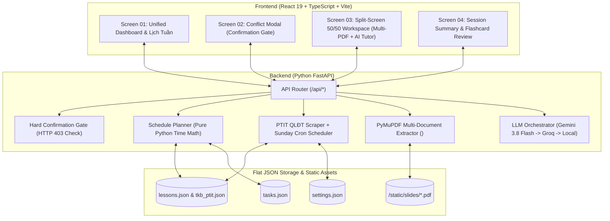

# 🎓 EasyPlan AI Agent — Trợ lý Học tập Chủ động & Đồng bộ Lịch QLĐT PTIT

> **EasyPlan AI Agent** là nền tảng Web kết hợp **Quản lý Thời khóa biểu Thông minh** và **Trợ giảng AI Cá nhân hóa** dành cho sinh viên Đại học (đặc biệt tối ưu cho cổng **QLĐT PTIT** — Học viện Công nghệ Bưu chính Viễn thông). Hệ thống tự động đồng bộ lịch học cố định trên trường, phát hiện xung đột với lịch tự học cá nhân, đề xuất lộ trình ôn tập từ nhiều tài liệu Slide PDF, và cung cấp không gian học tập sâu (**Split-Screen 50/50 Deep Working Workspace**) tích hợp Pomodoro, Checklist và AI Trợ giảng.

---

## 📌 Mục lục
1. [Tóm tắt Dự án & Giá trị Cốt lõi](#-1-tóm-tắt-dự-án--giá-trị-cốt-lõi)
2. [Kiến trúc Hệ thống & Phân tách Real vs. Mock](#-2-kiến-trúc-hệ-thống--phân-tách-real-vs-mock)
3. [4 Màn hình Cốt lõi (Theo thiết kế Figma)](#-3-4-màn-hình-cốt-lõi-theo-thiết-kế-figma)
4. [Luồng 8 Bước Hoạt động của AI Agent](#-4-luồng-8-bước-hoạt-động-của-ai-agent)
5. [Đặc tả Dữ liệu Phẳng & 8 API Contracts](#-5-đặc-tả-dữ-liệu-phẳng--8-api-contracts)
6. [Quy tắc Bảo mật, Confirmation Gate & Xử lý 4 Edge Cases](#-6-quy-tắc-bảo-mật-confirmation-gate--xử-lý-4-edge-cases)
7. [Cấu trúc Thư mục Dự án](#-7-cấu-trúc-thư-mục-dự-án)
8. [Hướng dẫn Cài đặt & Chạy Local](#-8-hướng-dẫn-cài-đặt--chạy-local)
9. [Hướng dẫn Deploy (Production)](#-9-hướng-dẫn-deploy-production)

---

## 🚀 1. Tóm tắt Dự án & Giá trị Cốt lõi

Sinh viên đại học thường gặp 3 vấn đề lớn khi tự học:
1. **Lịch học trên trường thay đổi liên tục** (lịch học bù, lịch thi, đổi phòng trên cổng QLĐT) làm đảo lộn kế hoạch tự học cá nhân.
2. **Ma sát lớn khi bắt đầu ngồi vào bàn học**: Phải mở nhiều tab tìm slide PDF, tìm lịch, tra cứu tài liệu khiến sinh viên dễ trì hoãn.
3. **Bế tắc khi tự đọc slide hoặc gặp lỗi code (Debug)** mà không có người hướng dẫn ngay tại thời điểm đó.

**EasyPlan AI Agent** giải quyết triệt để thông qua 4 trụ cột:
- **🔄 Đồng bộ Lịch QLĐT PTIT Tự động & Gộp tiết thông minh**:
  - Người dùng chỉ cần nhập tài khoản QLĐT **1 lần duy nhất** trên giao diện Web.
  - Agent lưu thông tin và **tự động cào lịch vào mỗi cuối tuần (Chủ Nhật)** hoặc bất cứ khi nào người dùng bấm nút **Đồng bộ lịch QLĐT**.
  - Tự động gộp các tiết học liên tiếp của cùng một môn học trong ngày (ví dụ: Tiết 7 [1 tiết] + Tiết 8 [2 tiết] $\rightarrow$ Ca học liền mạch `13:00 - 15:50`).
  - Tự động chuyển sang dữ liệu dự phòng (`tkb_ptit.json` / `qldt_fallback_response.json` gồm 31 tuần học kỳ) nếu cổng QLĐT của trường bị quá tải hoặc bảo trì.
- **🛡️ Phát hiện Xung đột & Chốt chặn Confirmation Gate (`HTTP 403`)**:
  - Thuật toán Python thuần tính toán chính xác sự chồng lấn giữa **Lịch cố định trên trường (`lessons.json`)** và **Lịch tự học linh hoạt (`tasks.json`)**, tìm khung giờ trống thay thế và hiển thị Modal xin phép người dùng.
  - **Tuyệt đối không tự ý ghi đè lịch** nếu thiếu sự xác nhận tường minh (`user_confirmed === true`).
- **📚 Tạo Lộ trình Học từ Nhiều File PDF (`PyMuPDF` + `Gemini 3.8 Flash`)**:
  - Hỗ trợ đính kèm **nhiều tài liệu PDF trong cùng 1 buổi học**.
  - Trích xuất văn bản thực tế từ tất cả các file PDF bằng `PyMuPDF` (`fitz`), chia nhỏ mục tiêu (`subtasks`) và xếp vào các khung giờ trống trước ngày thi.
- **🖥️ Phòng học Tập trung 1-Click (Split-Screen 50/50 Deep Working Workspace)**:
  - **1-Click Entry**: Từ Banner trang chủ, bấm 1 nút vào thẳng phòng học đã mở sẵn bộ tài liệu PDF bên trái và công cụ học tập bên phải.
  - **AI Trợ giảng (`gemini-3.8-flash` + Groq Fallback)**: Trả lời câu hỏi lý thuyết bám sát các file PDF của buổi học, debug code C/C++/Python, chủ động hỏi thăm sau **10 phút không thao tác** (kèm Cooldown 300s chống spam), và tạo **Flashcard ôn tập cuối buổi**.

---

## 🏗️ 2. Kiến trúc Hệ thống & Phân tách Real vs. Mock



### Bảng Phân tách Phạm vi Thực tế (Real) vs. Giả lập (Mock)

| Hạng mục | Phân loại | Chi tiết triển khai kỹ thuật |
| :--- | :---: | :--- |
| **Cào lịch QLĐT PTIT & Gộp tiết** | **REAL** | Đăng nhập API QLĐT PTIT (`pn-signin`), lấy TKB tuần (`w-locdstkbtuanusertheohocky`), gộp tiết liên tiếp và tự động fallback về `tkb_ptit.json` khi lỗi mạng. |
| **Tự động cào lịch Chủ Nhật** | **REAL** | Background task trong FastAPI lifespan kiểm tra mỗi 30 phút vào ngày Chủ Nhật để tự động đồng bộ lịch mới. |
| **Phát hiện xung đột & Tìm giờ trống** | **REAL** | Thuật toán Python thuần (`planner.py`), không dùng LLM tính giờ để tránh ảo giác (Hallucination). |
| **Internet Time API (Thời gian thực)** | **REAL** | Gọi `timeapi.io` (fallback Google HTTP `Date` header) lấy ngày giờ hiện tại Việt Nam (UTC+7), đảm bảo không bao giờ xếp lịch trước ngày hiện tại. |
| **Quản lý Đa Lộ trình & Xóa Lộ trình** | **REAL** | Lưu trữ theo `roadmap_id`, cho phép xem thống kê tiến độ từng môn học, chọn và xóa từng lộ trình hoặc hàng loạt lộ trình khỏi thời khóa biểu. |
| **Chốt chặn Confirmation Gate** | **REAL** | Kiểm tra `type(user_confirmed) is bool and user_confirmed is True` ở tầng Python; trả về `HTTP 403 Forbidden` nếu vi phạm. |
| **Đọc nhiều file PDF (`PyMuPDF`)** | **REAL** | Sử dụng thư viện `fitz` (`PyMuPDF`) đọc văn bản từ tất cả các file PDF đính kèm trong buổi học, hỗ trợ upload nhiều file `.pdf` từ máy tính. |
| **AI Trợ giảng & Tạo Lộ trình** | **REAL** | Gọi **Google Gemini (`gemini-3.8-flash`)** qua SDK `google-genai` (`client.interactions.create`), tự động fallback sang **Groq API (`llama-3.3-70b-versatile`)**. |
| **Dự báo Nguy cơ Trễ hạn (Delay Risk)** | **REAL + HEURISTIC** | Tự động phát hiện các buổi tự học bị lỡ (đã qua ngày chưa hoàn thành), gắn nhãn `⏰ Chậm tiến độ` và đề xuất khung giờ học bù tối ưu không trùng lịch trường. |

---

## 🖥️ 3. 4 Màn hình Cốt lõi (Theo thiết kế Figma)

1. **Màn hình 01 — Unified Dashboard & Weekly Schedule**:
   - Header hiển thị trạng thái nguồn lịch (`Live QLĐT API` hoặc `Cache tkb_ptit`), nút **Đồng bộ lịch QLĐT**, **🗺️ Quản lý lộ trình**, **✨ Tạo lộ trình AI (Nhiều PDF)**, **⚠️ Tạo xung đột mẫu**, và **⚙️ Tài khoản QLĐT & API Key**.
   - **Thanh chuyển tuần trực quan ngay trên bảng lịch**: Hỗ trợ chuyển `Tuần trước`, `Tuần sau`, danh sách thả xuống 31 tuần, nút động **`🎯 Về tuần hiện tại (Tuần X)`** và badge hiển thị ngày thời gian thực `🌐 Hôm nay: YYYY-MM-DD`.
   - **Banner 1-Click Enter**: Hiển thị phiên tự học sắp tới với nút `[VÀO TỰ HỌC NGAY →]`.
   - **Lưới Thời khóa biểu 7 ngày**: Phân biệt trực quan **Lịch cố định trên trường** (Thẻ xanh dương), **Phiên tự học AI** (Thẻ xanh lá), và **Phiên bị xung đột** (Viền đỏ nét đứt), highlight cột ngày hôm nay thực tế.
   - **Sidebar phải**:
     - **Việc cần tự học (To-do list)**: Thu nhỏ tối ưu chỉ hiển thị 2-3 buổi học sắp tới / hôm nay kèm nút `[Xem thêm / Thu gọn]`, banner cảnh báo các buổi `⏰ Chậm tiến độ` (đã qua ngày chưa học xong) và nút mở nhanh `🗺️ Quản lý lộ trình`.
     - **Widget Dự báo nguy cơ trễ hạn**: Phân tích các buổi bị bỏ lỡ, tính toán tỷ lệ rủi ro và đề xuất nút hành động `[➕ Xếp lịch học bù vào khung giờ trống]` (có Confirmation Gate).
     - **Thanh tiến độ mục tiêu tuần**: Đếm tỷ lệ hoàn thành các buổi học trong tuần.
   - **Modal Quản lý Lộ trình Học tập**: Cho phép xem danh sách tất cả các lộ trình môn học đã tạo, thống kê số buổi hoàn thành/sắp tới/chậm tiến độ, chọn từng lộ trình hoặc "Chọn tất cả" và thực hiện xóa an toàn khỏi thời khóa biểu.
2. **Màn hình 02 — Conflict Resolution Modal (Confirmation Gate)**:
   - Tự động bật lên khi phát hiện lịch học trên trường đè lên lịch tự học cá nhân.
   - Đặt cạnh nhau **Lịch cố định QLĐT** và **Phiên tự học bị trùng**, hiển thị khung giờ trống gợi ý của Agent, cho phép người dùng tự chỉnh lại giờ hoặc bấm `[Đồng ý dời lịch]`.
3. **Màn hình 03 — Split-Screen 50/50 Deep Working Workspace**:
   - **Nửa trái (50%)**: Thanh tab chuyển đổi giữa **nhiều tài liệu PDF** trong cùng buổi học (`1. INT1306_Chuong3_CayNhiPhan.pdf`, `2. INT1306_BaiTap_ThucHanh_CayNhiPhan.pdf`, ...), nút `+ Thêm PDF` (hỗ trợ chọn nhiều file cùng lúc), trình xem PDF trực tiếp và tab xem văn bản trích xuất `<DOCUMENT_DATA>`.
   - **Nửa phải (50%)**: Đồng hồ **Pomodoro 25:00**, **Checklist mục tiêu (`subtasks`)**, ô ghi chú cá nhân, **AI Trợ giảng** (hỗ trợ hiển thị Markdown, khung dán Code Debug, nút test 10 phút không thao tác), và tab **Flashcard Ôn tập**.
4. **Màn hình 04 — Session Summary Card**:
   - Thống kê tổng số phút tập trung (`total_focus_minutes`), số Pomodoro hoàn thành, tỷ lệ hoàn thành Checklist (%), danh sách các mục còn tồn đọng cho buổi học tiếp theo và ghi chú cá nhân.

---

## 🔄 4. Luồng 8 Bước Hoạt động của AI Agent

1. **Bước 1 (Trigger Sync)**: Người dùng mở ứng dụng / bấm đồng bộ hoặc bộ lập lịch Chủ Nhật tự động kích hoạt `POST /api/schedule/sync`.
2. **Bước 2 (Scrape & Normalize)**: Agent đăng nhập QLĐT PTIT lấy thời khóa biểu, gộp các tiết liền kề và lưu vào `lessons.json`.
3. **Bước 3 (Conflict Detection - Read-Only)**: Đối chiếu `lessons.json` với `tasks.json`. Nếu có xung đột, tính toán khung giờ trống nhưng **chưa sửa file**.
4. **Bước 4 (Confirmation Gate)**: Hiển thị đề xuất trên UI. Chỉ khi người dùng bấm xác nhận (`user_confirmed: true`), API `POST /api/schedule/confirm-reschedule` hoặc `POST /api/roadmap/confirm-save` mới ghi xuống `tasks.json`.
5. **Bước 5 (1-Click Enter & Multi-PDF Extraction)**: Khi bấm vào học (`GET /api/workspace/enter/{task_id}`), `PyMuPDF` trích xuất toàn bộ nội dung các file PDF của buổi học vào bộ nhớ đệm `<DOCUMENT_DATA>`.
6. **Bước 6 (Contextual Tutoring & Code Debugging)**: Sinh viên hỏi bài hoặc gửi đoạn code lỗi qua `POST /api/tutor/chat`; Agent gửi kèm `<DOCUMENT_DATA>` tới `gemini-3.8-flash` (fallback sang Groq nếu lỗi).
7. **Bước 7 (Proactive Inactivity Nudge)**: Nếu 10 phút không thao tác, Frontend gọi `POST /api/tutor/inactivity-check`; Agent gửi lời nhắc bám sát `subtask` đang làm dở (kèm Cooldown 300s).
8. **Bước 8 (Session Complete & Summary)**: Khi kết thúc buổi học (`POST /api/workspace/complete`), hệ thống cập nhật tiến độ vào `tasks.json` và trả về thẻ tổng kết.

---

## 📡 5. Đặc tả Dữ liệu Phẳng & 8 API Contracts

| STT | Method & Endpoint | Chức năng chính | Confirmation Gate |
| :-: | :--- | :--- | :---: |
| **1** | `POST /api/schedule/sync` | Đồng bộ lịch QLĐT PTIT, gộp tiết & kiểm tra xung đột (Read-only). | Không (Read-only) |
| **2** | `POST /api/schedule/confirm-reschedule` | Thực thi dời lịch tự học sang khung giờ trống. | **Có (`HTTP 403`)** |
| **3** | `POST /api/roadmap/generate` | Đọc nhiều file PDF & sinh lộ trình tự học nháp vào các khe giờ trống. | Không (Draft) |
| **3.1** | `POST /api/roadmap/confirm-save` | Lưu các phiên học từ lộ trình nháp vào `tasks.json`. | **Có (`HTTP 403`)** |
| **4** | `GET /api/workspace/enter/{task_id}` | Mở phòng học 50/50 & trích xuất văn bản từ toàn bộ PDF của buổi học. | Không (Read-only) |
| **5** | `POST /api/tutor/chat` | Hỏi đáp lý thuyết slide & debug code với `gemini-3.8-flash` / Groq. | Không |
| **6** | `POST /api/tutor/inactivity-check` | Nhắc nhở chủ động sau 10 phút đứng hình (Cooldown 300 giây). | Không |
| **7** | `POST /api/workspace/complete` | Hoàn thành phiên học, tính điểm Pomodoro & cập nhật `tasks.json`. | Không |

### Các Endpoint Bổ trợ Mở rộng
- `GET /api/schedule/today`: Lấy ngày giờ hiện tại trực tuyến qua Internet Time API (`timeapi.io` / Google Date header) ở múi giờ Việt Nam (UTC+7), tính toán chính xác tuần học hiện tại.
- `GET /api/roadmap/list`: Thống kê danh sách toàn bộ các lộ trình tự học hiện có theo từng môn, số buổi hoàn thành, sắp tới và trễ hạn.
- `POST /api/roadmap/delete`: Xóa 1 hoặc nhiều lộ trình học đã chọn và các phiên tự học liên quan khỏi `tasks.json`.
- `POST /api/schedule/add-extra-session`: Xếp thêm buổi học bù vào khe giờ trống khi có nguy cơ trễ hạn (**Có Confirmation Gate `HTTP 403`**).
- `POST /api/documents/upload`: Tải lên 1 hoặc nhiều file `.pdf` từ máy tính và gắn vào buổi học (`slide_urls`).
- `POST /api/documents/remove`: Gỡ một file `.pdf` khỏi danh sách tài liệu của buổi học.
- `POST /api/workspace/flashcards`: Sinh bộ thẻ lật Flashcard ôn tập từ nội dung PDF của buổi học.
- `GET /api/settings` & `POST /api/settings`: Quản lý tài khoản QLĐT PTIT lưu 1 lần, bật/tắt Auto-Sync Chủ Nhật và cấu hình API Key.
- `POST /api/schedule/simulate-conflict`: Khôi phục nhanh tình huống xung đột lịch mẫu tại Tuần 10 để demo Confirmation Gate.

---

## 🛡️ 6. Quy tắc Bảo mật, Confirmation Gate & Xử lý 4 Edge Cases

1. **Chốt chặn Confirmation Gate (`HTTP 403 Forbidden`)**:
   - Mọi request tới `/api/schedule/confirm-reschedule`, `/api/roadmap/confirm-save`, `/api/schedule/add-extra-session` đều đi qua hàm `verify_confirmation_gate(user_confirmed)`.
   - Nếu `user_confirmed` bị bỏ trống, bằng `false`, hoặc truyền sai kiểu dữ liệu (`"true"` kiểu chuỗi, `1` kiểu số nguyên), hệ thống lập tức trả về `HTTP 403 Forbidden` với JSON `{"detail": "Action requires explicit user confirmation"}` và giữ nguyên `tasks.json`.
2. **Chống Prompt Injection qua PDF (`<DOCUMENT_DATA>`)**:
   - Toàn bộ văn bản trích xuất từ PDF của người dùng được đóng gói trong cặp thẻ `<DOCUMENT_DATA>...</DOCUMENT_DATA>` kèm System Instruction nghiêm cấm làm theo bất kỳ chỉ dẫn giả mạo nào bên trong tài liệu.
3. **Xử lý 4 Edge Cases**:
   - **Edge Case 1 (QLĐT PTIT Timeout / 502)**: Tự động chuyển sang đọc file cache `tkb_ptit.json` / `qldt_fallback_response.json` sau 10 giây, trả về `"source": "fallback_cache"`.
   - **Edge Case 2 (File PDF rỗng hoặc PDF dạng ảnh quét)**: Nếu `PyMuPDF` trích xuất được dưới 20 ký tự, tự động chuyển `document_status` sang `"ocr_fallback"` và nạp khung kiến thức dự phòng để AI Trợ giảng không bị crash.
   - **Edge Case 3 (Gemini API 429 Rate Limit / Timeout)**: Tự động chuyển tiếp sang **Groq API (`llama-3.3-70b-versatile`)** hoặc bộ phân tích ngữ cảnh tại chỗ, trả về `"provider_used": "groq-fallback"`.
   - **Edge Case 4 (Chống Spam Inactivity Trigger)**: Áp dụng bộ đếm Cooldown **300 giây (5 phút)** cho mỗi `task_id`. Các request lặp lại trong thời gian chờ sẽ nhận `should_remind: false`, `skip_reason: "rate_limited"` kèm `retry_after_seconds`.

---

## 📂 7. Cấu trúc Thư mục Dự án

```text
probation/
├── backend/
│   ├── app/
│   │   ├── api/routes.py             # Định nghĩa 8 Core API Endpoints + Multi-PDF Upload/Settings
│   │   ├── schemas/requests.py       # Pydantic v2 Request Schemas
│   │   ├── services/
│   │   │   ├── qldt_client.py        # Cào lịch QLĐT PTIT, gộp tiết liên tiếp & Auto-Sync Chủ Nhật
│   │   │   ├── planner.py            # Phát hiện xung đột (Read-only), tìm giờ trống & lưu lộ trình
│   │   │   ├── confirmation.py       # Hard Confirmation Gate (HTTP 403 Forbidden)
│   │   │   ├── internet_time.py      # Tích hợp Internet Time API (timeapi.io + Google Date, Cache 5 phút)
│   │   │   ├── agent_tools.py        # PyMuPDF Multi-PDF Extractor, Gemini 3.8 Flash + Groq, Cooldown 300s
│   │   │   ├── json_storage.py       # Đọc/ghi nguyên tử lessons.json, tasks.json, settings.json
│   │   │   └── seed_data.py          # Khởi tạo file PDF mẫu & dữ liệu lịch PTIT 31 tuần
│   │   ├── config.py                 # Cấu hình đường dẫn & biến môi trường
│   │   └── main.py                   # FastAPI App, CORS, Static Files & Lifespan Scheduler
│   ├── data/
│   │   ├── tkb_ptit.json             # Dữ liệu thời khóa biểu PTIT 31 tuần
│   │   ├── qldt_fallback_response.json
│   │   ├── lessons.json              # Lịch học cố định phẳng (đã gộp tiết)
│   │   └── tasks.json                # Lịch tự học linh hoạt (hỗ trợ nhiều file PDF/buổi)
│   ├── static/slides/                # Thư mục lưu trữ các file Slide PDF bài giảng
│   ├── tests/test_api.py             # Bộ kiểm thử tự động 23 test cases (Pytest)
│   ├── Dockerfile                    # Dockerfile cho Backend FastAPI
│   ├── requirements.txt              # Danh sách thư viện Python
│   └── .env.example                  # Mẫu cấu hình biến môi trường
├── frontend/
│   ├── src/
│   │   ├── App.tsx                   # Giao diện 4 màn hình Figma, Multi-PDF Viewer & AI Tutor
│   │   ├── api.ts                    # Client kết nối Backend API
│   │   ├── types.ts                  # TypeScript Interfaces
│   │   ├── styles.css                # Giao diện chuẩn thiết kế Figma
│   │   └── main.tsx                  # React Entry Point
│   ├── Dockerfile                    # Dockerfile cho Frontend
│   ├── package.json
│   └── vite.config.ts                # Cấu hình Vite Proxy (/api & /static -> port 8000)
├── start_app.bat                     # [Windows] 1-Click tự động cài đặt & chạy cả Backend + Frontend
├── start_app.sh                      # [Linux/macOS] 1-Click tự động cài đặt & chạy cả Backend + Frontend
├── sync_github.bat                   # [Windows] Tự động git clone / git pull code mới nhất từ GitHub
├── sync_github.sh                    # [Linux/macOS] Tự động git clone / git pull code mới nhất từ GitHub
├── docker-compose.yml                # Chạy toàn bộ hệ thống với 1 lệnh Docker Compose
├── DEPLOYMENT.md                     # Hướng dẫn Deploy chi tiết (Render, Vercel, Docker, VPS)
└── README.md                         # Tài liệu tổng quan dự án
```

---

## 💻 8. Hướng dẫn Cài đặt & Chạy Local

### Yêu cầu hệ thống
- **Python**: `>= 3.10`
- **Node.js**: `>= 18.x`
- **Git**: Đã cài đặt trên máy

### ⚡ Cách 1: Tự động Tải Code, Cài đặt & Khởi chạy bằng 1 Click (Khuyên dùng)

Dự án cung cấp sẵn bộ script tự động hóa cho cả **Windows (`.bat`)** và **Linux / macOS (`.sh`)**:

#### A. Tự động tải mới (`git clone`) hoặc kéo bản cập nhật mới nhất (`git pull`) từ GitHub:
- **Trên Windows**: Nhấp đúp chuột chạy file **`sync_github.bat`** (hoặc chạy `.\sync_github.bat` trong Terminal).
- **Trên Linux / macOS**:
  ```bash
  chmod +x sync_github.sh start_app.sh
  ./sync_github.sh
  ```
*(Script sẽ tự động kiểm tra: nếu máy chưa có code sẽ tự `git clone`, nếu đã có code sẽ tự `git pull origin main`, đồng thời tự động cập nhật thư viện `pip` và `npm`).*

#### B. Tự động khởi chạy đồng thời cả Backend (`Port 8000`) & Frontend (`Port 5173`):
- **Trên Windows**: Nhấp đúp chuột chạy file **`start_app.bat`** (tự động tạo `.venv`, cài `node_modules` nếu thiếu, bật 2 cửa sổ server và mở thẳng trình duyệt tại `http://localhost:5173`).
- **Trên Linux / macOS**:
  ```bash
  ./start_app.sh
  ```
  *(Nhấn `Ctrl + C` để dừng đồng thời cả Backend và Frontend).*

---

### 🛠️ Cách 2: Chạy Thủ công Từng Cửa sổ Terminal

### Bước 1: Cài đặt & Khởi chạy Backend (Cổng `8000`)
```bash
cd backend

# Tạo môi trường ảo (nếu chưa có)
python -m venv .venv

# Kích hoạt môi trường ảo
# Trên Windows PowerShell:
.\.venv\Scripts\Activate.ps1
# Trên macOS/Linux:
# source .venv/bin/activate

# Cài đặt thư viện
pip install -r requirements.txt

# Tạo file .env từ mẫu (hoặc nhập trực tiếp trên giao diện Web sau khi chạy)
cp .env.example .env

# Chạy server FastAPI
python -m uvicorn app.main:app --reload --port 8000
```
- **API Endpoint**: `http://127.0.0.1:8000`
- **Swagger UI (Tài liệu API tương tác)**: `http://127.0.0.1:8000/docs`

### Bước 2: Cài đặt & Khởi chạy Frontend (Cổng `5173`)
Mở một cửa sổ terminal mới:
```bash
cd frontend

# Cài đặt dependencies
npm install

# Chạy môi trường phát triển
npm run dev
```
- Mở trình duyệt truy cập: **`http://localhost:5173`**

### Bước 3: Chạy Bộ Kiểm thử Tự động (Pytest)
```bash
cd backend
python -m pytest -v
```
*(Toàn bộ 23/23 test cases kiểm tra 8 API Contracts, Confirmation Gate `403`, Internet Time API, quản lý đa lộ trình, gộp tiết QLĐT, trích xuất nhiều file PDF và Cooldown 300s đều đạt `PASSED`).*

---

## 🌐 9. Hướng dẫn Deploy (Production)

Xem hướng dẫn chi tiết từng bước tại file **[DEPLOYMENT.md](./DEPLOYMENT.md)**, bao gồm 3 phương án phổ biến:

### Phương án nhanh 1: Chạy bằng Docker Compose (1 lệnh duy nhất)
```bash
docker compose up -d --build
```
- Backend chạy tại `http://localhost:8000`
- Frontend chạy tại `http://localhost:5173`

### Phương án nhanh 2: Deploy Cloud Miễn phí (Render + Vercel)
1. **Backend (Render.com / Railway.app)**:
   - Root Directory: `backend`
   - Build Command: `pip install -r requirements.txt`
   - Start Command: `uvicorn app.main:app --host 0.0.0.0 --port $PORT`
   - Environment Variables: `GEMINI_API_KEY`, `GROQ_API_KEY`, `QLDT_HOC_KY=20261`.
2. **Frontend (Vercel / Netlify)**:
   - Root Directory: `frontend`
   - Build Command: `npm run build`
   - Output Directory: `dist`
   - Environment Variable: `VITE_API_BASE=https://<ten-backend-cua-ban>.onrender.com`
